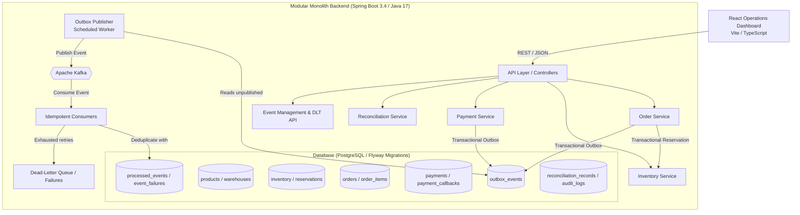

# Distributed Order Fulfilment and Reconciliation Platform

A high-reliability distributed order fulfilment, atomic inventory reservation, transactional outbox, asynchronous event processing, payment simulation, and reconciliation platform built with **Spring Boot 3.4 (Java 17)** and a **React 19 + TypeScript + Vite** operations dashboard.

---

## 1. Architecture Overview

The system is architected as a clean **Modular Monolith** adhering to strict domain boundaries with **PostgreSQL as the source of truth**:



### Core Modules
* **`catalog`**: Products and warehouse facilities with positive constraint validations.
* **`inventory`**: Stock levels, deterministic warehouse allocation, atomic conditional reservations, and stock invariant enforcement.
* **`orders`**: Multi-item order creation, lifecycle state transitions, canonical payload hashing, and database-enforced idempotency.
* **`payments`**: Payment authorizations, outcome simulations (`SUCCEEDED`, `FAILED`, `TIMED_OUT`), and idempotent webhook callback ingestion.
* **`events`**: Transactional outbox table, asynchronous Kafka publishing, consumer deduplication via `processed_events`, exponential backoff, and Dead-Letter Topic (DLT) management.
* **`reconciliation`**: Discrepancy detector (cancelled orders with successful payments, missing payments, reservation inconsistencies, stale pending orders) and idempotent corrective actions.
* **`common`**: Global exception mapping, audit logging, and `X-Correlation-Id` propagation via MDC.

---

## 2. Invariants & Key Guarantees

| Invariant | Guarantee & Implementation Mechanism |
| :--- | :--- |
| **Zero Overselling** | Conditional atomic SQL updates (`UPDATE inventory SET available_qty = available_qty - ? WHERE available_qty >= ?`) with deterministic warehouse ordering (`ORDER BY warehouse_id`) using pessimistic write locks (`PESSIMISTIC_WRITE`). Tested with 100 concurrent requests against 10 stock items: exactly 10 succeed, 90 fail. |
| **All-or-Nothing Multi-Item** | If any item line in a multi-item order cannot be fully allocated across eligible warehouses, the entire transaction rolls back (`InsufficientStockException`). |
| **Stock Tracking Invariant** | `available_qty + reserved_qty + fulfilled_qty == tracked_total` holds true across all lifecycle transitions (reserve, cancel, expire, fulfil). |
| **Order Idempotency** | Orders require an `Idempotency-Key` header. Same key + identical payload returns the existing order safely. Same key + different payload returns `HTTP 409 Conflict`. Race conditions resolve deterministically via PostgreSQL unique constraint. |
| **Dual-Write Protection** | Domain state changes and outbox events are committed inside the **same atomic database transaction**. |
| **At-Least-Once Delivery Tolerance** | Event consumers track processed event IDs in a durable `processed_events` table within the consumer's local transaction. Duplicate event deliveries produce zero side effects. |
| **Late Callback Protection** | Payment callbacks check order state before applying transitions. A delayed `SUCCEEDED` callback for an already `CANCELLED` order does not revert the order to `CONFIRMED`; instead, it records the payment and flags a reconciliation mismatch for review. |
| **Idempotent Reconciliation** | Repeated runs of the reconciliation engine detect active discrepancies without creating duplicate unresolved records or duplicating simulated actions. |

---

## 3. Data Model & Schema (Flyway Migrations)

All database tables are version-controlled via Flyway migrations in `src/main/resources/db/migration`:

1. `V1__foundation.sql`: Audit logs (`audit_logs`) and common structures.
2. `V2__catalog_and_inventory.sql`: `products`, `warehouses`, and `inventory` with tracking columns.
3. `V3__inventory_reservations.sql`: `reservations` referencing orders, products, and warehouses.
4. `V4__orders.sql`: `orders` and `order_items` with unique constraint `uq_orders_idempotency_key` and canonical `request_hash`.
5. `V5__events_and_outbox.sql`: `outbox_events`, composite-keyed `processed_events`, and `event_failures` (DLT).
6. `V6__payments_and_reconciliation.sql`: `payments`, `payment_callbacks`, and `reconciliation_records`.

---

## 4. API Specification & cURL Examples

### Base URLs
* **Backend API**: `http://localhost:8080`
* **Frontend Operations Dashboard**: `http://localhost:5173` (proxies `/api` and `/actuator` to `8080`)

### 1. Catalog & Inventory
```bash
# List products
curl -s http://localhost:8080/api/products

# List warehouses
curl -s http://localhost:8080/api/warehouses

# Get grouped inventory status
curl -s http://localhost:8080/api/inventory

# Adjust inventory stock (+10 units)
curl -s -X POST http://localhost:8080/api/inventory/adjustments \
  -H "Content-Type: application/json" \
  -d '{"productId":"<PRODUCT_UUID>","warehouseId":"<WAREHOUSE_UUID>","quantity":10}'
```

### 2. Orders
```bash
# Create multi-item order (requires Idempotency-Key)
curl -s -X POST http://localhost:8080/api/orders \
  -H "Content-Type: application/json" \
  -H "Idempotency-Key: ord-key-001" \
  -d '{
    "currency": "USD",
    "items": [
      {"productId": "<PRODUCT_UUID>", "quantity": 2, "unitPrice": 25.00}
    ]
  }'

# List orders (filter by status: PENDING_PAYMENT, CONFIRMED, FULFILLED, CANCELLED)
curl -s "http://localhost:8080/api/orders?status=PENDING_PAYMENT"

# Cancel an order (releases reserved inventory atomically)
curl -s -X POST http://localhost:8080/api/orders/<ORDER_UUID>/cancel

# Fulfil a confirmed order (moves reserved stock to fulfilled)
curl -s -X POST http://localhost:8080/api/orders/<ORDER_UUID>/fulfil
```

### 3. Payments & Webhook Callbacks
```bash
# Simulate gateway outcome (SUCCEEDED, FAILED, TIMED_OUT)
curl -s -X POST http://localhost:8080/api/orders/<ORDER_UUID>/payments/simulate \
  -H "Content-Type: application/json" \
  -d '{"outcome":"SUCCEEDED","amount":50.00,"currency":"USD"}'

# Ingest asynchronous webhook callback (idempotent deduplication by callbackId)
curl -s -X POST http://localhost:8080/api/payments/callbacks \
  -H "Content-Type: application/json" \
  -d '{"callbackId":"cb-web-991","paymentId":"<PAYMENT_UUID>","status":"SUCCEEDED"}'

# List payments & callback audit logs
curl -s http://localhost:8080/api/payments
curl -s http://localhost:8080/api/payments/callbacks
```

### 4. Reconciliation
```bash
# Execute reconciliation scan
curl -s -X POST http://localhost:8080/api/reconciliation/run

# List reconciliation mismatch records
curl -s http://localhost:8080/api/reconciliation/records

# Resolve or dismiss a mismatch
curl -s -X POST http://localhost:8080/api/reconciliation/records/<RECORD_UUID>/resolve \
  -H "Content-Type: application/json" \
  -d '{"action":"RESOLVE","notes":"Customer contacted; refund review completed."}'
```

### 5. Failed Events & DLT Operations
```bash
# List failed/dead-lettered events
curl -s http://localhost:8080/api/events/failures

# Retry a single failed event
curl -s -X POST http://localhost:8080/api/events/failures/<FAILURE_UUID>/retry

# Trigger outbox publisher sweep
curl -s -X POST http://localhost:8080/api/events/outbox/publish
```

---

## 5. Operations Dashboard

Built with **React 19, TypeScript, and Vite**, providing a comprehensive operational view:

1. **Orders View**:
   * Multi-item order creation form with dynamic line items, validation, and live price calculation.
   * Status filter tabs (`ALL`, `PENDING_PAYMENT`, `CONFIRMED`, `FULFILLED`, `CANCELLED`).
   * Order details modal showing line totals, inventory reservation records, and lifecycle timestamps.
   * Actions: Confirm Order, Cancel Order, Fulfil Order, and Simulate Payment.

2. **Inventory & Warehouse Allocation**:
   * Product and warehouse stock distribution breakdown.
   * Available, Reserved, and Fulfilled counters with stacked progress allocation bars.
   * Stock Invariant integrity indicator (`available + reserved + fulfilled == trackedTotal`).
   * Stock adjustment modal supporting positive (restock) and negative (write-off) stock adjustments.

3. **Payment Operations**:
   * Authorizations table with status badges and provider references.
   * Webhook callback audit trail with payload inspector modal.
   * Callback simulator modal with payment selection dropdown and row-level callback triggers.

4. **Reconciliation Console**:
   * Automatic and on-demand mismatch detection across orders, payments, and stock.
   * Displays mismatch category, affected entities, and simulated corrective actions.
   * Resolution modal for operators to mark records `RESOLVED` or `DISMISSED` with audit notes.

5. **Failed Events & DLT**:
   * Dead-lettered and retrying event stream with failure summary metrics.
   * Single-click retry and batch retry for eligible transient failures.
   * Manual Outbox trigger to flush pending events.

---

## 6. Local Setup & Running Instructions

### Prerequisites
* **Java 17** (e.g. Eclipse Adoptium OpenJDK 17)
* **Maven 3.9+**
* **Node.js 18+** & npm

### Running the Backend

#### Development Mode (Default with In-Memory H2 in PostgreSQL Mode)
The application includes an in-memory development profile (`dev`) that boots instantly without requiring an external PostgreSQL instance or Kafka cluster:
```powershell
cd backend
mvn spring-boot:run "-Dspring-boot.run.profiles=dev"
```
* Runs on: `http://localhost:8080`
* Automatically runs Flyway migrations and seeds initial product (`WIDGET-RED`) and warehouse (`WH-EAST`) with 10 units.

#### Production Mode (with external PostgreSQL and Kafka)
Copy `.env.example` to `.env` and set your credentials:
```powershell
SPRING_PROFILES_ACTIVE=local
DATABASE_URL=jdbc:postgresql://localhost:5432/fulfilment
DATABASE_USERNAME=postgres
DATABASE_PASSWORD=your_password
KAFKA_BOOTSTRAP_SERVERS=localhost:9092
```
Then launch:
```powershell
cd backend
mvn spring-boot:run
```

### Running the Frontend
```powershell
cd frontend
npm install
npm run dev
```
* Dashboard runs at: `http://localhost:5173`
* Vite dev server automatically proxies `/api` and `/actuator` calls to the Spring Boot backend at `http://localhost:8080`.

---

## 7. Automated Test Suite

Run the full automated test suite using Maven:
```powershell
cd backend
mvn clean test
```

### Test Suite Highlights
* **65 tests, 0 failures, 0 errors**:
  * `InventoryReservationEngineTest`: Concurrency stress test verifying that **100 concurrent threads attempting to reserve 1 unit against 10 stock results in exactly 10 successes and 90 failures**, with final available quantity equal to 0.
  * `OrderLifecycleTest` & `OrderApiTest`: Tests all valid state machine transitions, rejects illegal transitions, and validates all-or-nothing rollback on insufficient stock.
  * `OrderServiceIdempotencyTest`: Validates identical payloads returning original order and mismatched payloads triggering HTTP 409 Conflict.
  * `PaymentProcessingTest` & `PaymentApiTest`: Tests outcome simulations, idempotent duplicate webhook callback deduplication, and late callback handling.
  * `ReconciliationTest`: Verifies detection of successful payments on cancelled orders, missing payments on confirmed orders, reservation state discrepancies, and idempotent re-execution.
  * `EventProcessingTest` & `FailedEventWorkflowTest`: Tests outbox record creation, consumer deduplication via `processed_events`, retry backoff limits, and DLT routing.

---

## 8. Architectural Trade-offs & Design Decisions

1. **Modular Monolith over Distributed Microservices**:
   * *Trade-off*: Single deployable artifact rather than 6 distinct network services.
   * *Rationale*: Guarantees atomic database transactions across inventory and orders without complex two-phase commit (2PC) or Saga orchestrators, while maintaining modular package boundaries for future service extraction.
2. **PostgreSQL as Source of Truth over Distributed Locks (Redis)**:
   * *Trade-off*: Row-level write locks on PostgreSQL rather than Redis Redlock.
   * *Rationale*: Eliminates clock-drift vulnerabilities, split-brain scenarios, and split state across Redis and PostgreSQL. Deterministic sorting by warehouse ID prevents deadlocks.
3. **Transactional Outbox over Direct Kafka Publishing**:
   * *Trade-off*: Requires a background publisher polling the outbox table.
   * *Rationale*: Guarantees that business state changes are never lost if Kafka is temporarily unreachable during the commit phase (dual-write problem solved).