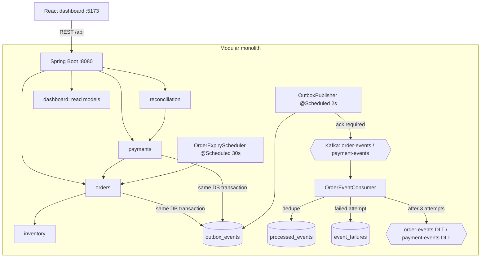

# Distributed Order Fulfilment and Reconciliation Platform

Order fulfilment with atomic multi-warehouse inventory reservation, a transactional outbox published to Apache Kafka,
idempotent consumers with bounded retries and dead-lettering, simulated payments with callbacks, and reconciliation
with audited corrective actions. Backend: **Spring Boot 3.4 / Java 17** (modular monolith). Frontend: **React 19 +
TypeScript + Vite** operations dashboard. **PostgreSQL** is the source of truth. Runs natively on Windows; Docker is not required.

---

## 1. Architecture



| Module | Responsibility |
| --- | --- |
| `catalog` | Products and warehouses. |
| `inventory` | Stock per product/warehouse (`available`, `reserved`, `fulfilled`), reservation, release, fulfilment. |
| `orders` | Idempotent order creation, lifecycle, request-outcome history (`order_requests`), automatic expiry. |
| `payments` | Simulated payment attempts (SUCCEEDED / FAILED / TIMED_OUT), provider callbacks with deduplication, simulated refunds. |
| `events` | Transactional outbox, Kafka publisher, idempotent consumer, retries, dead-letter, fault injection for demos. |
| `reconciliation` | Compares persisted payments with persisted orders and reservations; mismatch records and corrective actions. |
| `dashboard` | Read-only aggregation for the UI (`/api/orders/{id}/details`, `/api/audit`). |
| `common` | Audit log, error mapping, correlation ids, scheduling config. |

### Key guarantees

| Concern | Mechanism |
| --- | --- |
| No overselling | Inventory rows locked `PESSIMISTIC_WRITE` in deterministic order, plus conditional `UPDATE … WHERE available_qty >= :qty`; DB `CHECK (available_qty >= 0)`. |
| No partial multi-product reservation | All lines are reserved in one transaction; any shortfall throws `InsufficientStockException` and rolls everything back. |
| No duplicate orders | `Idempotency-Key` header + unique constraint; same key + same payload returns the original order, different payload → 409. |
| No lost events | Outbox row written in the same transaction as the business change; published only after Kafka acknowledges (`published_via = KAFKA`). |
| No fake publication | Without Kafka, events stay pending. The H2 test profile can opt into `simulate-without-kafka`, which stamps `published_via = SIMULATED`. |
| No duplicate effects | Consumer writes its business effect and the `processed_events (consumer, event_id)` marker in one transaction. |
| Bounded retries | Failed attempt → `event_failures` (attempts, timestamps, error) → rethrow → Kafka redelivery after 2 s. After 3 attempts → `DEAD_LETTERED`, forwarded to `<topic>.DLT`, offset committed. |
| Contradictory transitions | Order transitions are guarded under row locks (e.g. CANCELLED can never become CONFIRMED/FULFILLED). A late payment success on a cancelled order is recorded, not applied, and raises a reconciliation mismatch. |

### Rejected purchase attempts (design choice)

A request rejected for insufficient stock **does not become an order**. The `orders` table holds only real orders.
Every request outcome, including rejections, idempotent replays and key conflicts, is stored in **`order_requests`**
and shown on the **Order Requests** page. So "50 attempts against 10 units" shows up as 10 orders on the Orders page
and as 50 requests (10 ACCEPTED, 40 REJECTED_INSUFFICIENT_STOCK) on the Order Requests page.

### Order lifecycle

```
PENDING_PAYMENT ──payment SUCCEEDED / confirm──▶ CONFIRMED ──fulfil──▶ FULFILLED
       │
       ├──cancel────────────────▶ CANCELLED   (reservations released)
       └──expire (30 min, auto)─▶ CANCELLED   (reservations released, audit ORDER_EXPIRED)
```

Payment SUCCEEDED after cancellation/expiry: the order stays CANCELLED, the payment is recorded as SUCCEEDED and a
`PAYMENT_SUCCEEDED_ORDER_CANCELLED` reconciliation record is opened. The corrective action `REFUND_PAYMENT` marks the
payment REFUNDED and audits it.

---

## 2. Database schema (Flyway, `backend/src/main/resources/db/migration`)

| Migration | Tables |
| --- | --- |
| V1 | `schema_foundation` |
| V2 | `products`, `warehouses`, `inventory` (PK product+warehouse, non-negative checks), `audit_log` |
| V3 | `reservations` (order, product, warehouse, qty, status RESERVED/CONFIRMED/RELEASED/FULFILLED) |
| V4 | `orders` (unique `idempotency_key`, `request_hash`), `order_items` |
| V5 | `outbox_events`, `processed_events` (PK consumer+event), `event_failures` |
| V6 | `payments`, `payment_callbacks` (unique `provider_callback_id`), `reconciliation_records` (unique `mismatch_key`) |
| V7 | `outbox_events.published_via`, `order_requests`, `reconciliation_records.resolution_action/notes`, indexes |

---

## 3. Windows setup

### Prerequisites
* Java 17 (Temurin), Maven 3.9+, Node.js 18+.
* PostgreSQL 17 with a database `fulfilment` (`CREATE DATABASE fulfilment;`). Flyway creates the tables.
* Kafka 4.x in KRaft mode, e.g. `C:\kafka\kafka_2.13-4.3.1` with `log.dirs=C:/kafka/data` in `config\server.properties`.

### Environment variables

| Variable | Default | Notes |
| --- | --- | --- |
| `DATABASE_URL` | `jdbc:postgresql://localhost:5432/fulfilment` | |
| `DATABASE_USERNAME` | `postgres` | |
| `DATABASE_PASSWORD` | — | Prompted for by the scripts; never commit it. |
| `KAFKA_BOOTSTRAP_SERVERS` | `localhost:9092` | |
| `RESERVATION_EXPIRY_MINUTES` | `30` | PENDING_PAYMENT orders older than this are expired automatically. |
| `RECONCILIATION_STALE_PENDING_MINUTES` | `60` | Threshold for STALE_PENDING_ORDER / STALE_PENDING_PAYMENT. |
| `EVENT_MAX_RETRIES` / `EVENT_RETRY_BACKOFF_MS` | `3` / `2000` | Consumer attempts before dead-lettering, and redelivery delay. |
| `OUTBOX_POLL_INTERVAL_MS` | `2000` | Outbox publisher poll interval. |

### Start the services (three PowerShell windows)

1. **Kafka** (KRaft; format storage once if `C:\kafka\data` is new: `bin\windows\kafka-storage.bat format ...`):
   ```powershell
   C:\kafka\kafka_2.13-4.3.1\bin\windows\kafka-server-start.bat C:\kafka\kafka_2.13-4.3.1\config\server.properties
   ```
   Check it: `Test-NetConnection localhost -Port 9092`. Topics are created by the backend on start
   (`order-events`, `payment-events`, `inventory-events`, `order-events.DLT`, `payment-events.DLT`).

2. **Backend** (prompts for the PostgreSQL password; offers to stop an older instance of *this* app on 8080, refuses to touch anything else):
   ```powershell
   cd C:\Users\hp\Desktop\Assignment
   powershell -ExecutionPolicy Bypass -File .\scripts\start-backend.ps1
   ```
   Equivalent manual steps: set the env vars above, then `cd backend; mvn spring-boot:run`.
   Healthy when `curl http://localhost:8080/actuator/health` returns `UP`.

3. **Frontend**:
   ```powershell
   cd C:\Users\hp\Desktop\Assignment\frontend
   npm.cmd install
   npm.cmd run dev
   ```
   Open http://localhost:5173. (Use `npm.cmd` if PowerShell's execution policy blocks `npm.ps1`.)

---

## 4. Tests

```powershell
# H2-only suite (no external services). PostgreSQL/Kafka tests are reported as SKIPPED, never as passed.
cd backend; mvn test

# Full suite including PostgreSQL + Kafka integration tests (prompts for the password):
powershell -ExecutionPolicy Bypass -File .\scripts\run-integration-tests.ps1
powershell -ExecutionPolicy Bypass -File .\scripts\run-integration-tests.ps1 -Test PostgresOrderConcurrencyIntegrationTest
```

| Area | Tests |
| --- | --- |
| Concurrent reservations | `InventoryReservationEngineTest` (H2), `PostgresInventoryConcurrencyIntegrationTest` (service level, PostgreSQL), `PostgresOrderConcurrencyIntegrationTest` (100 HTTP order requests vs 10 units on PostgreSQL; asserts orders, reservations, `order_requests`) |
| Order outcomes, multi-product, cancellation, expiry | `OrderRequestOutcomeTest`, `OrderLifecycleTest`, `OrderApiTest` |
| Duplicate events, retries, DLT | `ConsumerRetryAndDeadLetterTest`, `EventProcessingTest`, `FailedEventWorkflowTest` |
| Outbox publication semantics | `OutboxPublisherUnitTest` (no Kafka → stays pending; failed send → attempt + error; ack → KAFKA) |
| Real Kafka workflows | `KafkaAutomaticPipelineIntegrationTest` (scheduler publishes and listener consumes with no manual call; transient failure recovers; persistent failure dead-lettered), `KafkaOutboxEndToEndIntegrationTest`, `KafkaBrokerIntegrationTest` |
| Payments and duplicate callbacks | `PaymentProcessingTest`, `PaymentApiTest`, `PaymentReconciliationFlowTest` |
| Reconciliation and corrective actions | `ReconciliationTest`, `PaymentReconciliationFlowTest` (late success → single record → REFUND_PAYMENT; double charge; amount mismatch) |

Service-level reservation stress test with configurable size (calls the reservation service directly, **not** the order API):
```powershell
cd backend
mvn "-Dtest=PostgresInventoryConcurrencyIntegrationTest#testConcurrentReservationsAgainstLimitedStockOnPostgres" "-Ddemo.stock=10" "-Ddemo.requests=50" test
```

---

## 5. Demonstrations against the running stack

Both scripts use only the public HTTP API and verify results by reading persisted state back.

```powershell
# 50 concurrent POST /api/orders (1 unit each, unique Idempotency-Keys) against 10 units, then 5 retried keys
node scripts\concurrency-demo.mjs
node scripts\concurrency-demo.mjs --stock 25 --requests 100 --replays 10

# Full workflow: multi-product order, automatic Kafka publish/consume, payment fail/success, duplicate callbacks,
# fulfilment, cancellation release, timeout + late success, reconciliation + refund, retry recovery, DLT, duplicate delivery
node scripts\e2e-demo.mjs
```

Expected concurrency result: 10 × HTTP 201, 40 × HTTP 409 "Insufficient stock", 10 persisted orders, 0 available /
10 reserved, `order_requests` ACCEPTED 10 / REJECTED_INSUFFICIENT_STOCK 40 / IDEMPOTENT_REPLAY 5. The 10 orders stay
PENDING_PAYMENT until paid, cancelled, or expired after 30 minutes, which then releases the stock.

---

## 6. Dashboard walkthrough

| Page | What it shows (all from the API) |
| --- | --- |
| **Orders** | Persisted orders with status-group counts, products/units, total, reservation and payment status, created/updated times, search by id / key / SKU. **Open** shows the full order: products with SKUs and prices, per-warehouse reservations, status history, payment attempts with provider references, provider callbacks, every Kafka event with publication and consumption state, reconciliation records, request history, and the full audit trail. Actions: simulate payment (any outcome or amount), deliver a late callback, re-send a duplicate callback, cancel, expire, confirm without payment, fulfil, re-deliver an event. Auto-refreshes every 3 s. |
| **Order Requests** | Every creation request and its outcome; filter by idempotency-key prefix (e.g. a demo run id). |
| **Products / Warehouses** | Catalog management. |
| **Inventory** | Available / reserved / fulfilled per product and warehouse, adjustments. |
| **Payments** | Payment attempts, callback audit, manual callback sender. |
| **Reconciliation** | Run reconciliation; mismatch records; corrective actions (REFUND_PAYMENT, EXPIRE_ORDER, RESOLVE, DISMISS); audit trail of runs and decisions. |
| **Event Pipeline** | Outbox counters, every event's publication (attempts, errors, `published_via`) and consumer outcome; worker-failure simulation; re-delivery. |
| **Failed Events / DLT** | Retrying and dead-lettered events with attempts and errors; manual retry. |

Suggested demo: run `node scripts\concurrency-demo.mjs`, then open Orders (search the printed run id) and Order Requests
(key prefix). On Event Pipeline, arm 2 failures for `ORDER_CANCELLED` and cancel an order: the event is retried and
then recovers. Arm 5 failures and cancel another order: it is dead-lettered and appears under Failed Events / DLT.

---

## 7. API reference

Base URL `http://localhost:8080`. Errors use `{ "timestamp", "status", "error", "message", "path", "correlationId", "details" }`.

```bash
# Catalog & inventory
curl -X POST localhost:8080/api/products   -H "Content-Type: application/json" -d '{"sku":"SKU-1","name":"Widget","active":true}'
curl -X POST localhost:8080/api/warehouses -H "Content-Type: application/json" -d '{"code":"WH-1","name":"Main","active":true}'
curl -X POST localhost:8080/api/inventory/initialize -H "Content-Type: application/json" -d '{"productId":"<P>","warehouseId":"<W>","initialStock":10}'
curl -X POST localhost:8080/api/inventory/adjustments -H "Content-Type: application/json" -d '{"productId":"<P>","warehouseId":"<W>","availableDelta":5}'
curl localhost:8080/api/inventory

# Orders
curl -X POST localhost:8080/api/orders -H "Content-Type: application/json" -H "Idempotency-Key: ord-001" \
  -d '{"currency":"USD","items":[{"productId":"<P1>","quantity":2,"unitPrice":10.00},{"productId":"<P2>","quantity":1,"unitPrice":5.00}]}'
#   201 {"id":"…","status":"PENDING_PAYMENT","totalAmount":25.00,"items":[…],"reservations":[…]}
#   409 {"message":"Insufficient stock for product …"}  -> recorded as REJECTED_INSUFFICIENT_STOCK
curl "localhost:8080/api/orders?status=PENDING_PAYMENT"
curl localhost:8080/api/orders/<ORDER>/details          # full order read model
curl -X POST localhost:8080/api/orders/<ORDER>/cancel   # also /confirm /fulfil /expire
curl "localhost:8080/api/orders/requests?keyPrefix=demo-&outcome=REJECTED_INSUFFICIENT_STOCK&limit=100"
curl "localhost:8080/api/orders/requests/summary?keyPrefix=demo-"
#   {"ACCEPTED":10,"IDEMPOTENT_REPLAY":5,"REJECTED_INSUFFICIENT_STOCK":40,"REJECTED_IDEMPOTENCY_CONFLICT":0,"REJECTED_INVALID":0,"TOTAL":55}

# Payments
curl -X POST localhost:8080/api/orders/<ORDER>/payments/simulate -H "Content-Type: application/json" -d '{"outcome":"TIMED_OUT"}'
#   outcome: SUCCEEDED | FAILED | TIMED_OUT ; optional amount, currency (default: order total)
curl -X POST localhost:8080/api/payments/callbacks -H "Content-Type: application/json" \
  -d '{"callbackId":"cb-123","paymentId":"<PAYMENT>","result":"SUCCEEDED"}'   # same callbackId again -> ignored + audited
curl "localhost:8080/api/payments?orderId=<ORDER>"
curl "localhost:8080/api/payments/callbacks?paymentId=<PAYMENT>"

# Reconciliation
curl -X POST localhost:8080/api/reconciliation/run
#   {"runId":"…","ordersChecked":57,"paymentsChecked":5,"detectedCount":1,"existingCount":3,"records":[…]}
curl "localhost:8080/api/reconciliation/records?status=ACTION_REQUIRED"
curl -X POST localhost:8080/api/reconciliation/records/<RECORD>/resolve -H "Content-Type: application/json" \
  -d '{"action":"REFUND_PAYMENT","notes":"customer refunded"}'   # REFUND_PAYMENT | EXPIRE_ORDER | RESOLVE | DISMISS

# Events
curl localhost:8080/api/events/summary
curl "localhost:8080/api/events/outbox?status=PENDING"          # PENDING | PUBLISHED | (all)
curl -X POST localhost:8080/api/events/outbox/<EVENT>/redeliver  # duplicate delivery demo
curl -X POST localhost:8080/api/events/outbox/publish            # one poll now (the scheduler runs every 2 s anyway)
curl -X POST localhost:8080/api/events/fault-injection -H "Content-Type: application/json" \
  -d '{"failures":2,"eventType":"ORDER_CANCELLED","aggregateId":"<ORDER>"}'   # failures=0 disarms
curl localhost:8080/api/events/failures/dead-lettered
curl -X POST localhost:8080/api/events/failures/<FAILURE>/retry

# Audit
curl "localhost:8080/api/audit?entityType=reconciliation_run&limit=20"
```

Reconciliation checks: payment SUCCEEDED for a cancelled order; confirmed/fulfilled order without a successful payment;
reservation state inconsistent with order state; stale pending orders/payments; more than one successful payment per
order; successful payment amount or currency different from the order.

---

## 8. Known limitations

* Single application instance assumed. The outbox poller is synchronized inside one JVM; with several instances, use
  `SELECT … FOR UPDATE SKIP LOCKED`. Delivery is at-least-once and consumers are idempotent.
* The consumer's business effect is an audited processing record (`CONSUMED_<type>`). State changes happen
  synchronously in the owning module, and Kafka is used for asynchronous processing and observability. A real downstream
  worker (shipping, notifications) would plug into the same idempotent consumer.
* Unit prices come from the order request (the catalog has no price list).
* Fault injection is in-memory and per instance. It is explicitly armed and audited, and exists only for demonstrations.
* Running the PostgreSQL/Kafka integration tests while the dev backend is up shares the database and topics. The test
  profile uses its own consumer name and group to stay isolated, but test orders appear in the dashboard.
* The automatic expiry job expires every PENDING_PAYMENT order older than 30 minutes, including old demo/test orders.
